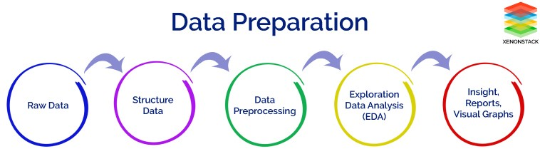

# Exploratory Data Analysis Guide

En este notebook encontrarás una guía paso a paso para llevar a cabo un Análisis Exporatorio de Datos. Un análisis exploratorio nos va a ayudar a limpiar bien un dataset y entender las relaciones que tenemos entre los datos.

**¿Cuáles son los objetivos que debe cubrir un Análisis exploratorio de datos? (EDA)**

- Extraer información útil de variables, desechando las que no aporten nada.
- Identificar outliers, missings y errores humanos
- Entender la relación entre las variables.
- Y lo más importante, responder y solucionar un problema de negocio

**¿Cuándo tendremos que realizar un EDA?**

- Cuando haya que realizar un análisis del negocio, para comprender cómo funciona.
- Análisis de la calidad de los datos de una o varias fuentes de datos.
- Reporte del estado del negocio, ya sea ocasional o recurrente.
- Análisis de cómo ha ido una determinada decisión de negocio, plan de marketing o lanzamiento de producto.
- Análisis previo a un modelo de Machine Learning. Es importante entender las relaciones entre los datos.

### 1. Business case & Data Collection

1.**Business understanding**: lo primero de todo es identificar la necesidad, el problema de negocio que intentamos resolver.

2.**Hipótesis**: Tendremos que realizar afirmaciones sobre los datos y comprobar si de verdad se cumple, basándonos en los mismos. Estos dos primeros puntos son fundamentales ya que siempre hay que tener una meta cuando realicemos un EDA. Con la hipótesis tiene que venir un **plan de acción**. Tenemos unos datos, unos posibles resultados...pero si ocurre esto o lo otro, ¿qué hacemos? ¿qué decisiones vamos a tomar?

3.**Requerimientos de los datos**: en este punto habrá que listar los datos necesarios, a alto nivel, para llevar a cabo el análisis: por ejemplo, los datos de ventas de los ultimos 3 años desagregados por tipo de cliente, o datos de bolsa de los ultimos 2 meses de las empresas A, B y C.

4.**Disponibilidad**: primer punto de inflexión en el proyecto. Si no podemos acceder al dato necesario para la analítica, bien porque no existe o bien porque pertenece a alguna organización, no será posible continuar por esa vía y quizá haya que replantear el proyecto y/o acudir a otras fuentes.

5.**Adquisición de datos**: es el momento de ir a por los datos, ya sea en bases de datos de la empresa, datasets públicos, APIs, Web Scrapping, comprando bases de datos o escribiendo a organizaciones para que cedan sus datos.

6.**Calidad**: segundo punto de inflexión en el proyecto. Es fundamental que los datos sean válidos para el análisis, suficientes, que no tengan excesivos missings, ni estén manipulados.

7.**Revisión de hipótesis**: una vez tenemos todos los datos recolectados, quizá tengamos que replantear la hipótesis al darnos cuenta de que tenemos otros datos u otras variables con las que no contábamos. Si tenemos menos variables que las iniciales, también habrá que replantearse el objetivo del proyecto.

### 2. Data Understanding

8.**Exploratorio inicial**: en este momento realizaremos un primer análisis de las variables que tenemos en el dataset, obteniendo la información básica: cantidad de tablas, número de columnas, de filas, naturaleza de las variables, tipos de los datos, primeros registros y proporción de missings.

9.**Tabla de variables**: no está de más tener inventariadas todas las variables que vayas a usar, la naturaleza de las mismas, el tipo de dato y lo que piensas que va a aportar al análisis. Esto puede ser una hoja de cálculo perfectamente.

### 3. Data Cleaning

10.**Juntar tablas**: si queremos obtener relaciones entre variables o graficar datos de diferentes fuentes, tendremos que unirlos en una única tabla mediante sentencias como merge o join.

11.**Eliminar columnas**: columnas que no sirvan para el análisis, identificadores, constantes, columnas a null.

12.**Formato de los datos**: tras una primera eliminación de columnas, hay que forzar los tipos de los datos a lo que deberían ser. Asegúrate que un string es un string, que un date es un date y un numérico está en el formato que deseamos, de lo contrario tendremos errores en el posterior tratamiento.

13.**Missings**: analiza los valores missings de las variables e investig por qué tienes nulls. En Machine Learning se suelen sustituir por medias o modas pero en Data Analysis resulta interesante analizar por qué hay missings en algunos registros.

14.**Outliers**: al igual que con los missings, los outliers suelen meter ruido innecesario en los modelos, y distorsiona su entrenamiento con datos que no son representativos de la muestra, por lo que se suelen eliminar. En el caso de Data Analysis no es necesario, sino que resulta interesante destacar outliers y por qué de los mismos.¿Cómo detectar outliers?

    14.1 Histogramas

    14.2 Diagramas de caja

    14.3 Scatter plots

    14.4 Cuartiles, rango, mínimo y máximo

15.**Duplicados**: elimina los registros duplicados.

16.**Escalado**: si queremos comparar variables con distintas escalas, tendremos que transformarlas a la misma mediante un MinMaxScaler.

17.**Transformaciones**: sacar nuevas variables a partir de las anteriores, mediante ratios numéricos, binning, datos de las fechas (año, dia, mes).

### 4. Analysis

La limpieza de datos ocupa la mayor parte del tiempo, a partir de este momento nos queda sacar estadísticos, gráficas, analizar los resultados y contrastarlos con las hipótesis iniciales.

18.**Análisis univariante**: en este apartado se pretende describir la variable mediante diferentes estadísticos, así como graficando su función de distribución para ver la forma, asimetría, centralidad y dispersión de la misma.

    18.1 Estadísticos de centralidad: media, mediana, moda, cuartiles y percentiles

    18.2 Estadísticos de dispersión: varianza, desviación estándar, rango, mínimo y máximo

    18.2 Gráficas: Tablas de frecuencias, histogramas, función densidad de probabilidad, diagrama de caja, diagrama de barras, violin plot, swarm plot.

19.**Análisis bivariante**: una vez comprendidas las variables por separado, tendremos que empezar a ver relaciones entre las mismas.

    19.1 Agrupados: agrupar por un campo categórico y calcular estadísticos como el conteo, la media, suma...

    19.2 Gráficas: summary tables (describe de pandas), scatter plots, diagrama de barras, cross table o binning

20.**Análisis multivariante**: ver de manera gráfica la relación de todas con todas.

    20.1 Gráficas: heatmap de correlación, grid de gráficas mediante pairplot.

### 5. Resultados

21.**Contraste con hipótesis**: finalmente, analizaremos los resultados obtenidos del análisis, buscaremos insights y comprobaremos si responde positivamente o negativamente a nuestra hipótesis inicial. ¿Hemos respondido a la necesidad de negocio planteada al principio? De ser así, continuaríamos con el siguiente paso y en caso contrario, habrá que volver a los puntos 3 y 4 (requerimientos de los datos).

22.**Plan de acción**: ¿qué vamos a hacer en función de los resultados? Esto es algo que ya deberíamos tener claro antes del análisis pero puede variar en función de los resultados.

23.**Productivización**: ¿es necesario que esta información esté en un dashboard alojado en un hosting de la empresa para que sea consumible por más empleados?

24.**Comunicación, presentación de resultados**: una vez ya hemos realizado el análisis, obtenido resultados y contrastado hipótesis, queda enseñarlo. Se realiza una presentación con un buen hilo conductor desde el problema inicial hasta las conclusiones basadas en los datos.

25.**Transmitir conocimiento**: documentación/charlas de descubrimientos sobre los datos, insights o tecnologías.
